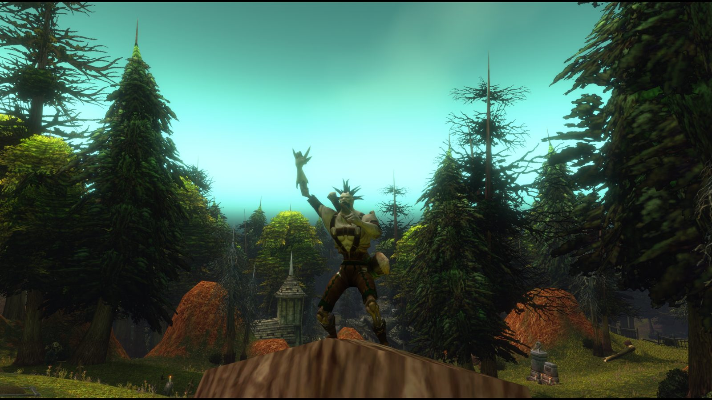
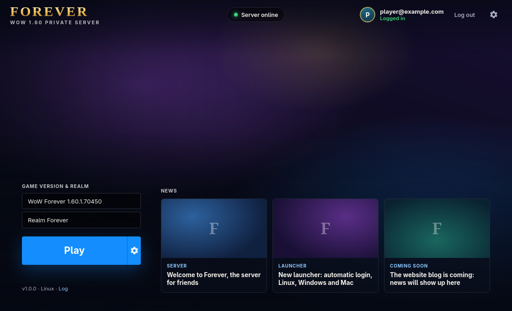
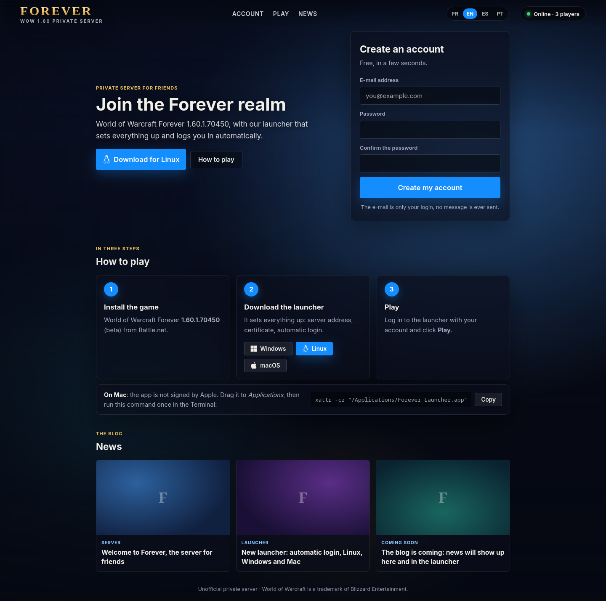
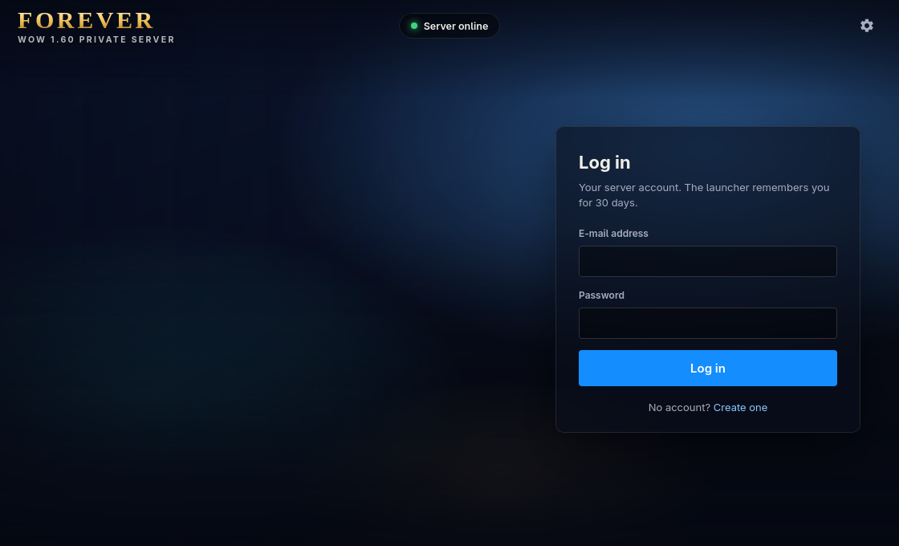
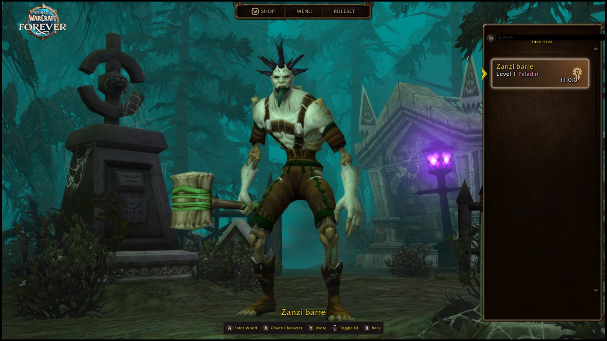

# WoWForEver

Сервер **World of Warcraft Forever Beta** на основе
[ветки forever проекта TrinityCore](https://github.com/advocaite/TrinityCore/tree/forever).
В комплект входят Docker-конфигурация, MySQL, сервер авторизации, игровой сервер,
сайт регистрации и исходники лаунчера для Windows, Linux и macOS.

Основа нашего репозитория — [jibay442/forever_docker](https://github.com/jibay442/forever_docker).
История исходного проекта и лицензия сохранены.

**Документированная сборка клиента: 1.60.1.70450.** У нас клиент **1.60.1.70532**:
пользователь подтвердил вход в мир, бой и выполнение нескольких квестов. Полная совместимость не подтверждена. Настройка `CLIENT_BUILD=70532` только
меняет записи версии в базе; она не исправляет различия протокола и игровых данных.
На компьютере пользователя сервер собран и запущен; в логах остаются ошибки отдельных пакетов клиента 70532.



| Лаунчер | Сайт |
|---|---|
|  |  |
|  |  |

## Как устроен проект

1. Docker запускает MySQL, `worldserver`, `bnetserver` и сайт.
2. Сайт создаёт учётные записи через SOAP игрового сервера. Регистрация ограничена по IP.
3. Собственный лаунчер настраивает подключение: запись hosts, доверие к сертификату
   нашего сервера и ключ клиента в памяти. Игровые файлы при этом не изменяются.
4. Игрок входит через лаунчер и запускает игру. По описанию исходного проекта
   лаунчер запоминает вход на 30 дней.

Сайт и лаунчер поддерживают английский, французский, испанский и португальский
языки. Этот README переведён на русский; интерфейс приложения не переводился.
Репозиторий не содержит клиента или игровых данных Blizzard: нужные серверу
данные извлекаются из собственного клиента.

## Требования

- Linux с Docker Engine и Docker Compose v2, Git и OpenSSL.
- По оценке исходного проекта: 8 ГБ ОЗУ для сборки, 4 ГБ для работы и около
  20 ГБ диска под сервер. Клиенту и временным файлам нужен дополнительный запас места.
- Клиент нужной сборки с доступными ресурсами для извлечения карт.
  Потоковая установка, которая лишь запускает игру, не гарантирует наличие всех ресурсов.
- Интернет для загрузки контейнеров, исходников и серверной базы данных.

На Windows можно начать с Docker Desktop с Linux-контейнерами и WSL2 Ubuntu.
Команды ниже выполняются в Linux/WSL, а не в PowerShell. Исходный проект
документирует Linux; этот вариант запуска через WSL в нашем окружении не проверялся.

## Тестовый запуск на своём компьютере

Для первой проверки не нужны домен, VPS и проброс портов на роутере.

### 1. Получить проект

```bash
git clone https://github.com/Domenklay/WoWForEver.git
cd WoWForEver
cp .env.example .env
```

Если проект уже скачан, откройте его каталог и обновите его через `git pull --ff-only`.
Не перезаписывайте существующий `.env`.

### 2. Заполнить .env

Задайте **собственные разные пароли** для `MYSQL_ROOT_PASSWORD`, `DB_PASSWORD`
и `SOAP_PASSWORD`; не оставляйте `change-me-*`. По ограничениям исходного проекта
не используйте в паролях одинарные и двойные кавычки. Файл `.env` не добавляется в Git.

Остальные параметры для локального теста:

```dotenv
PUBLIC_ADDRESS=127.0.0.1
REALM_LOCAL_ADDRESS=127.0.0.1
CLIENT_BUILD=70450
BUILD_JOBS=2
WOW_DIR=/mnt/e
EXTRACT_MMAPS=0
MMAP_PATHFINDING=0
LAUNCHER_REPO=Domenklay/WoWForEver
```

`WOW_DIR=/mnt/e` подходит **только если** в корне диска E: действительно находятся
`Data`, `.build.info` и `_classic_beta_`. Если клиент лежит в другой папке,
укажите её путь в Linux. Нельзя указывать только каталог `_classic_beta_`.
Например, `E:/Games/World of Warcraft` в WSL будет `/mnt/e/Games/World of Warcraft`.

Укажите `HOST_UID` и `HOST_GID` согласно выводу `id -u` и `id -g` в Linux/WSL,
чтобы extractor мог писать в `data/`.

Для нашего клиента **70532** значение `CLIENT_BUILD=70532` допустимо только как
экспериментальная попытка подключения. Сборка 70450 — исходная документированная
цель; подмена числа не делает клиент 70532 совместимым с ней.

Проверьте окружение и каталог клиента:

```bash
docker version
docker compose version
ls -la /mnt/e/.build.info /mnt/e/Data
```

Замените `/mnt/e` своим путём. Извлечение ресурсов требует больше данных, чем
минимальная потоковая установка клиента; при отсутствующих ресурсах сначала
завершите установку/проверку собственного клиента.

### 3. Создать сертификаты, собрать сервер, извлечь данные

```bash
./scripts/gen-certs.sh
docker compose config -q
docker compose build
docker compose run --rm extractor
```

Сборка TrinityCore занимает время. `BUILD_JOBS=2` уменьшает расход памяти;
исходная оценка — около 2 ГБ ОЗУ на процесс компиляции крупных файлов.

Extractor должен завершиться успешно и создать в `data/` каталоги `dbc`, `gt`,
`cameras`, `maps`, `vmaps`. Для отключённого поиска пути `mmaps` не нужны.
При ошибке извлечения не переходите к запуску: сохраните полный текст ошибки.

Сертификаты создаются для нашего сервера. **Никому не передавайте**
`certs/ca/forever_root_ca.key`, `certs/forever.key.pem` и `.env`.
Публичный `certs/ca/forever_root_ca.crt` понадобится лаунчеру.

### 4. Запустить и проверить сервер

```bash
docker compose up -d
docker compose ps
docker compose logs -f worldserver bnetserver
```

Первый запуск импортирует базу. Не перезапускайте сервер и не запускайте обновление
во время этого импорта. `Ctrl+C` закрывает просмотр логов, но не останавливает контейнеры.

После завершения импорта проверьте сайт локально на порту 8088 и создайте тестовую
учётную запись. Открытый сайт сам по себе не доказывает работоспособность игрового сервера.
Если сайт ещё не может создать аккаунт, проверьте логи `worldserver` и `web`.

Альтернативный способ создать аккаунт — интерактивная консоль:

```bash
docker compose attach worldserver
```

В консоли сервера выполните команду со своими тестовыми данными:

```text
bnetaccount create mail@example.com YourUniqueTestPassword
```

Отсоединиться от консоли без остановки сервера: **Ctrl+P, затем Ctrl+Q**.

### 5. Подготовить лаунчер именно для нашего сервера

`LAUNCHER_REPO` сам по себе не создаёт установщик. Для сборки лаунчера:

1. Откройте **Actions** нашего GitHub-репозитория и включите workflows, если требуется.
2. В **Settings → Secrets and variables → Actions → Variables** добавьте:

   | Переменная | Значение |
   |---|---|
   | `FOREVER_CA_CERT` | Полный текст публичного `certs/ca/forever_root_ca.crt`, не приватного ключа |
   | `FOREVER_SERVER_ADDRESS` | `127.0.0.1` для теста на том же ПК |
   | `FOREVER_SERVER_NAME` | Необязательно: имя сервера, например `WoWForEver` |
   | `FOREVER_WEBSITE` | Необязательно: адрес сайта для игроков |

3. В **Actions → Launcher → Run workflow** укажите версию, например `1.0.0`.
4. После успешной сборки скачайте Windows-установщик из Releases. Сборка также
   создаёт Linux AppImage и macOS dmg. Публикация тега `v*` тоже запускает workflow.
5. Установите лаунчер нашего сервера, настройте путь к клиенту и проверьте подключение.
   На первом запуске он настраивает hosts и доверие к нашему сертификату.

В исходном проекте лаунчер ориентирован на 70450. Не считаем его совместимым с
70532 до отдельной проверки. Уже имеющийся **Burralis/Forever Beta Launcher**
настроен на `logon.foreverwow.biz:1119`: запуск через него не доказывает подключение
к нашему серверу. Поддержка собственного адреса, сертификата и сборки должна быть проверена отдельно.

Проверка успеха: вход в свой аккаунт, список миров, создание персонажа, вход в мир,
движение, взаимодействие с NPC и бой. При сбое сохраните ошибку клиента и логи:

```bash
docker compose logs --tail=200 worldserver bnetserver web
```

Перед передачей логов удалите из них пароли, токены и персональные данные.

### 6. Остановить тест

```bash
docker compose stop
```

Контейнеры можно снова запустить через `docker compose up -d`.
`docker compose down` удаляет контейнеры и сеть, сохраняя именованный том MySQL.
**Не используйте `docker compose down -v`, если хотите сохранить базу и персонажей.**

## Подключение из локальной сети или интернета

Если сервер и игровой клиент находятся на разных ПК, `127.0.0.1` не подходит:
укажите доступный адрес сервера в `PUBLIC_ADDRESS` и корректный локальный адрес
в `REALM_LOCAL_ADDRESS`. Соберите лаунчер с тем же адресом.

| TCP-порт | Служба | Назначение |
|---|---|---|
| 1119 | bnetserver | Авторизация Battle.net через TLS |
| 8081 | bnetserver | REST API авторизации |
| 8085 | worldserver | Игровое подключение |
| 80, 443 | Traefik / Dokploy | Только для публикации сайта |

Для доступа из интернета настройте firewall и проброс портов. MySQL (3306)
и SOAP (7878) наружу не открывайте. Compose публикует игровые порты на всех
интерфейсах по умолчанию; для личного теста ограничьте доступ локальным firewall.
Сайт по умолчанию слушает только `127.0.0.1:8088`.

Для сайта через Traefik задайте `SITE_DOMAIN` и нужные параметры Traefik:

```bash
docker compose -f docker-compose.yml -f docker-compose.traefik.yml up -d
```

Развёртывание через Dokploy описано в [docs/DOKPLOY.md](docs/DOKPLOY.md)
(исходная инструкция на английском).

## Сборка лаунчера вручную и macOS

Лаунчер написан на Tauri 2 (Rust + HTML/CSS/JS). Задайте те же переменные сборки,
либо поместите публичный сертификат в `app/src-tauri/resources/forever_root_ca.crt`.
Затем выполните:

```bash
cd app
npx @tauri-apps/cli@2 build
```

На Linux требуется `libwebkit2gtk-4.1-dev` и остальные зависимости Tauri.
Особенности macOS: [docs/MACOS.md](docs/MACOS.md). Приложение не подписано Apple;
исходный проект предлагает после установки:

```bash
xattr -cr "/Applications/Forever Launcher.app"
```

## Настройка и обновление

- Параметры ядра: строки `Key = Value` в `overrides/worldserver.conf`
  и `overrides/bnetserver.conf`.
- Дополнительные исправления: `docker/patches/`; описание —
  [docker/patches/README.md](docker/patches/README.md).
- Перед обновлением сохраните базу и конфигурацию. Затем:

  ```bash
  docker compose build --no-cache
  docker compose up -d
  ```

  SQL-обновления применяются при запуске. Если сборка останавливается при применении
  патча, проверьте, не включено ли исправление в upstream. Не удаляйте патч вслепую.
- [Первый тестовый перенос NPC и квеста из 3.3.5](content/ports/northshire-335/README.md).
- [Цепочка Североземья: 5 квестов и 3 NPC из 3.3.5](content/ports/northshire-chain-335/README.md).
- [Проверка ресурсов Расколотых островов Legion](docs/zones/LEGION.ru.md).
- [Экспорт участка Даларана и проверка RAW-файлов](docs/zones/LEGION-EXPORT.ru.md).
- [Подготовка пакета тайла Даларана и отчёта о зависимостях](docs/zones/LEGION-PACKAGE.ru.md).
- [Пакетная установка приватных ресурсов в тестовую копию и откат](docs/zones/LEGION-INSTALL.ru.md).
- [Извлечение и проверка геометрии одного тайла Даларана](docs/zones/LEGION-GEOMETRY.ru.md).
- [Включение тестового Даларана через hotfix и откат](docs/zones/LEGION-ACTIVATE.ru.md).
- [Проверка вложенного каталога TVFS по отображению одной текстуры](docs/zones/LEGION-TVFS-TEXTURE.ru.md).
- [Синтетический CASC-стенд: ROOT, encoding и локальные индексы](docs/zones/CASC-SANDBOX.ru.md).
- [Обновление копии CASC и аудит настоящих манифестов](docs/zones/CASC-INCREMENTAL.ru.md).
- [Контрольный импорт нового FileDataID в отдельную копию клиента](docs/zones/CASC-CANARY.ru.md).
- [Экспериментальные мультиклассы: установка сервера и игрового аддона](mods/forever-subclass/README.ru.md).
- [Целевая модель мультикласса в стиле Ascension Freepick и план переноса](docs/ASCENSION-FREEPICK.ru.md).
- [План переноса контента из 3.3.5 и новых дополнений](docs/CUSTOMIZATION.ru.md).
- [Инструкции для AI-ассистентов](AGENTS.md).

## Лицензия

GNU GPL v2.0 или более поздняя версия, как у TrinityCore. См. [LICENSE](LICENSE).
Проект не связан с Blizzard Entertainment и не одобрен ею. World of Warcraft —
товарный знак Blizzard Entertainment. Для игровых данных нужен собственный доступ к игре.
