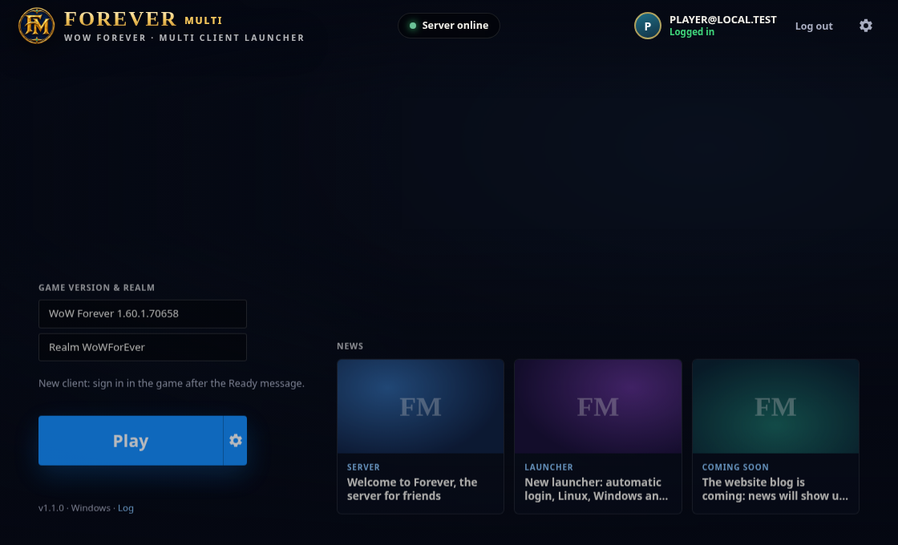
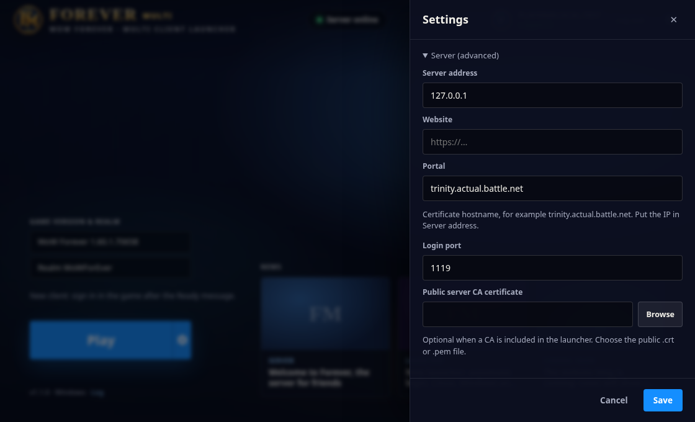

# WoW Forever Multi 1.1.0

Обновление нашего настольного лаунчера для новой установки **wowf**
(`_forever_/Wow.exe`) с сохранённой поддержкой беты
(`_classic_beta_/WowB.exe`). Название, значок FM и номер версии обновлены.
Идентификатор приложения и каталог настроек сохранены, поэтому прежняя
учётная запись и параметры сервера остаются доступны.

Предпросмотр интерфейса использует тестовые ответы сервера и пример учётной
записи; это не подтверждение входа в игровой мир:

## Windows

Артефакт сборки `WoW-Forever-Multi-Windows-1.1.0` содержит переносимый
`WoWForeverMulti.exe`, установщик NSIS, эту инструкцию и SHA256SUMS.txt.
Если публичный CA задан в переменных репозитория, он встроен в приложение
и добавлен в комплект как `forever_root_ca.crt`. Игры, игровых ресурсов,
серверных баз, приватных ключей и паролей в комплекте нет.

1. Закройте игру и временный запускатель PowerShell.
2. Откройте WoW Forever Multi. В настройках выберите
   `E:\WoWForEver-work\experiments\Forever-client-v3\_forever_`.
   Можно выбрать и родительский `Forever-client-v3`: папка игры определится
   автоматически. `Wow.exe` переименовывать не требуется.
3. Для локального сервера: Address `127.0.0.1`, Portal
   `trinity.actual.battle.net`, Login port `1119`. Адрес и имя сертификата
   теперь проверяются отдельно: IP в Portal не принимается.
4. Если CA не встроен или нужен другой сервер, выберите **публичный**
   `certs/ca/forever_root_ca.crt` в параметрах сертификата. Альтернатива —
   положить этот файл рядом с переносимым EXE. Файлы `.key` не используются.
5. Проверки в настройках показывают hosts и доверие к выбранному CA.
   Кнопка Fix использует обычное подтверждение Windows для изменения hosts
   и установки этого публичного CA. Проверка TLS остаётся включённой.
6. Войдите в лаунчер учётной записью нашего сервера и нажмите Play.
   Для нового Wow.exe вход в саму игру пока выполняется вручную,
   **после сообщения Server key ready**. Этот режим повторяет успешный
   контрольный запуск по DNS-имени. Автоматический вход через реестр
   сохранён для беты; контракт wowf ещё не подтверждён.

Лаунчер запускает выбранный EXE с отдельным `ForeverLauncher.wtf`, задаёт
DNS-имя вместе с портом и проверяет публичный ключ игрового сервера в памяти.
Поиск процесса ограничен полным путём выбранной игры, включая дочерний
bootstrap-процесс. Другой клиент с таким же именем из другой папки не выбирается.
Изменения исполняемого файла и архивов CASC для подключения не требуются.

Версия и язык читаются из активной строки нужного продукта в `.build.info`:
wowf для новой игры и wow_classic_beta для беты. Вместо выдуманного 70450
при отсутствии версии показывается имя игры без номера. Прежние пакеты
Даларана требуют отдельной подготовки под новую сборку.

## Исходники и сборка

Исходники приложения находятся в `app/src-tauri` (Rust/Tauri) и `app/ui`.
Ветка содержит предыдущие серверные изменения и инструменты миграции/CASC.
Сборка Windows запускается workflow **WoW Forever Multi Windows** и хранится
как артефакт, без публикации релиза и замены сервера.
Обычный workflow Launcher остаётся доступен для ручной сборки на трёх ОС.

Внешний вид FM — самостоятельная эмблема, созданная для проекта. Исходный PNG
и описание находятся в `app/branding`; размеры ICO/PNG/ICNS подготовлены
Tauri CLI. Официальные логотипы и изображения Blizzard не добавлялись.

## Что ещё нужно проверить

Ранее прямой запуск по правильному имени подтвердил TLS, авторизацию и
соединение с миром. Временный запускатель подтвердил настройку ключа группы 8,
после чего клиент завис на сером экране персонажей. Новая оболочка переносит
эти настройки в обычный лаунчер; сама по себе смена лаунчера **не подтверждает
устранение зависания персонажей**. Нужна повторная проверка на ПК с журналами
клиента и worldserver, если зависание сохранится.
